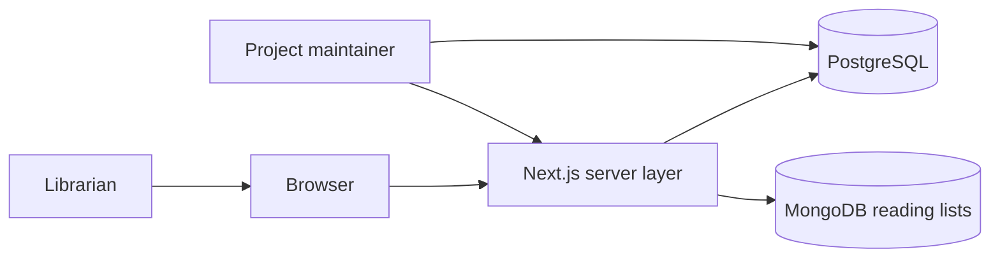

# Architecture Description (AD)

**Project:** ShelfSense
**Status:** Implemented architecture, subject to project review

## 1. System of interest and concerns

The system of interest is a single-library circulation application. Staff need reliable issue and return operations; maintainers need a schema they can reproduce and inspect; members need accurate availability and fine information. The primary architectural concern is preserving copy and loan integrity under concurrent staff actions.

## 2. Context view

The server layer owns authentication, request validation, and transaction boundaries. PostgreSQL owns circulation records, staff identities, access guards for administrator writes, and integrity constraints. MongoDB owns only curated reading-list documents. Browser code receives application responses and does not hold database credentials.

## 3. Container responsibilities

| Container | Responsibility | Boundary |
| --- | --- | --- |
| Next.js interface | Staff forms, search, circulation screens, readable errors | No direct SQL connection from browser |
| Server-side application code | Permission checks, policy lookup, transactional workflows | Uses parameterized queries; does not duplicate database uniqueness rules |
| PostgreSQL | Titles, authors, copies, members, loans, constraints, fine calculation | Authoritative system of record |
| MongoDB | Staff-curated reading lists with per-title notes | References PostgreSQL book IDs; no circulation truth |

## 4. Circulation interaction view

Issuing a copy is one database transaction:

1. Lock the member row, the title row, and the copy row in a consistent order.
2. Confirm the member is active, the copy is not withdrawn, the member is below the open-loan limit, and the hold rule permits issue.
3. Read the current policy and insert a loan with a policy snapshot.
4. Mark the borrower's own active hold for that title fulfilled, if they had one.
5. Commit. A partial unique index on open loans is the final guard against concurrent issue attempts.

Returning a copy locks the open loan, sets its return date once, and commits. The final fine is derived from the recorded return date and policy snapshot. The interface reports a conflict if the loan has already been returned.

This sequence is implemented by `issue_copy` and `return_copy` in the circulation migration, with the title lock and the hold steps added by the holds migration. The [Circulation workflow](circulation-workflow.md) records the lock order, the failure codes, and what the two-session concurrency check measured: the copy row lock, not the unique index, is what normally decides a race between two staff, and the index remains the guarantee against any writer that bypasses the workflow.

The title row lock exists because the hold rule is a comparison of counts, free copies against members waiting, and two staff acting at once could otherwise both conclude that a copy was spare and between them leave a queued member with nothing. [Discovery and reporting](discovery-and-reporting.md), section 3, states the full lock order and what each operation takes, and its two-session check measures the over-allocation case directly.

## 5. Data and security views

The relational model is described in the [Database Design Description](database-design-description.md). Copies, members, and loans retain stable identifiers. Historical loans are not deleted as part of normal workflows. Passwords use salted scrypt hashes; opaque session tokens are hashed before storage, expire after eight hours, and are sent in HTTP-only, SameSite cookies. Both API handlers and PostgreSQL guard administrator writes. The server sets the acting staff ID only within a transaction. This database guard assumes the database credentials and session context remain confined to the trusted server; it is not a defense against a compromised database account. Deployment secrets and member data are not committed.

## 6. Decisions and tradeoffs

| Decision | Rationale | Consequence |
| --- | --- | --- |
| Separate titles and copies | Availability concerns an individual physical item. | More than one row is needed for a multi-copy title. |
| Store policy snapshot on each loan | Fine results remain reproducible after a policy change. | Loan creation must copy current policy values. |
| Derive availability from open loans | Avoids a second mutable status that can disagree with loan history. | Availability queries need an indexed open-loan lookup, and a catalog browse has to be paginated against an ordered index rather than counting every title. |
| Hold a title, not a copy | A member waits for the work; any copy satisfies the wait. | Fulfillment is decided at issue time by counting free copies against the queue, not by attaching a copy to a hold in advance. |
| Reserve one copy per hold rather than blocking all lending | A single hold on a multi-copy title should not stop every walk-in borrowing it. | The rule needs a title-level lock so that concurrent issues cannot over-allocate the queue. |
| Keep circulation in PostgreSQL; use MongoDB for curated lists | Relational constraints protect loans while variable-length notes fit a document. | Lists display live title and availability data from PostgreSQL; a removed title is marked unavailable. |

Graph and vector databases are not part of this release. The course's NoSQL-or-vector criterion is addressed through a working MongoDB collection and create, read, update, and delete operations.

## 7. Verification approach

Database constraint tests, transaction/concurrency tests, server authorization tests, and end-to-end issue/return checks are linked to requirements and the application documentation.

Constraint and behavior tests exist for all six migrations as deterministic SQL scripts that roll their fixtures back. Two scripts run pairs of psql sessions for the one-open-loan rule and hold queue. Query plans were measured on a 20,000-title, 150,000-loan dataset; see [Query performance](query-performance.md). The application suite covers password verification and MongoDB collection behavior. Disposable-environment HTTP checks cover login, both staff roles, circulation, audit, reports, and reading-list CRUD; see [Application and NoSQL design](application-and-nosql.md).

The name and view-based structure are informed by [ISO/IEC/IEEE 42010:2022](https://www.iso.org/standard/74393.html). This tailored description is not asserted to conform to the full standard.
