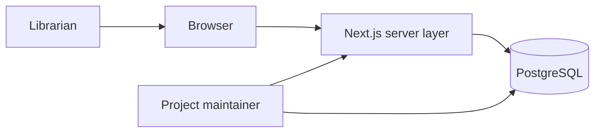

# Architecture Description (AD)

**Project:** ShelfSense
**Status:** Proposed architecture; implementation pending

## 1. System of interest and concerns

The system of interest is a single-library circulation application. Staff need reliable issue and return operations; maintainers need a schema they can reproduce and inspect; members need accurate availability and fine information. The primary architectural concern is preserving copy and loan integrity under concurrent staff actions.

## 2. Context view

The server layer owns authentication, authorization, validation, and transaction boundaries. PostgreSQL owns durable records and integrity constraints. Browser code receives application responses and does not hold database credentials.

## 3. Container responsibilities

| Container | Responsibility | Boundary |
| --- | --- | --- |
| Next.js interface | Staff forms, search, circulation screens, readable errors | No direct SQL connection from browser |
| Server-side application code | Permission checks, policy lookup, transactional workflows | Uses parameterized queries; does not duplicate database uniqueness rules |
| PostgreSQL | Titles, authors, copies, members, loans, constraints, fine calculation | Authoritative system of record |

## 4. Circulation interaction view

Issuing a copy is one database transaction:

1. Lock the member row and the copy row in a consistent order.
2. Confirm the member is active, the copy is not withdrawn, the member is below the open-loan limit, and any applicable hold rule permits issue.
3. Read the current policy and insert a loan with a policy snapshot.
4. Commit. A partial unique index on open loans is the final guard against concurrent issue attempts.

Returning a copy locks the open loan, sets its return date once, and commits. The final fine is derived from the recorded return date and policy snapshot. The interface reports a conflict if the loan has already been returned.

This sequence is implemented by `issue_copy` and `return_copy` in the circulation migration. The [Circulation workflow](circulation-workflow.md) records the lock order, the failure codes, and what the two-session concurrency check measured: the copy row lock, not the unique index, is what normally decides a race between two staff, and the index remains the guarantee against any writer that bypasses the workflow.

## 5. Data and security views

The relational model is described in the [Database Design Description](database-design-description.md). Copies, members, and loans retain stable identifiers. Historical loans are not deleted as part of normal workflows. Staff permissions will be checked by the server layer before mutations; database credentials stay in server-side configuration. Deployment secrets and member data will not be committed to the repository.

## 6. Decisions and tradeoffs

| Decision | Rationale | Consequence |
| --- | --- | --- |
| Separate titles and copies | Availability concerns an individual physical item. | More than one row is needed for a multi-copy title. |
| Store policy snapshot on each loan | Fine results remain reproducible after a policy change. | Loan creation must copy current policy values. |
| Derive availability from open loans | Avoids a second mutable status that can disagree with loan history. | Availability queries need an indexed open-loan lookup. |
| Keep PostgreSQL as sole authoritative store | Makes constraints and transactions reviewable for the DBMS course. | No independent NoSQL state in the core workflow. |

Neo4j and vector search may be evaluated as optional, isolated demonstrations after the transactional system works. They will not be required for circulation correctness.

## 7. Verification approach

Database constraint tests, transaction/concurrency tests, server authorization tests, and end-to-end issue/return tests will be linked to requirements. Query plans will be measured using representative fixture data before performance claims are made.

The name and view-based structure are informed by [ISO/IEC/IEEE 42010:2022](https://www.iso.org/standard/74393.html). This tailored description is not asserted to conform to the full standard.
