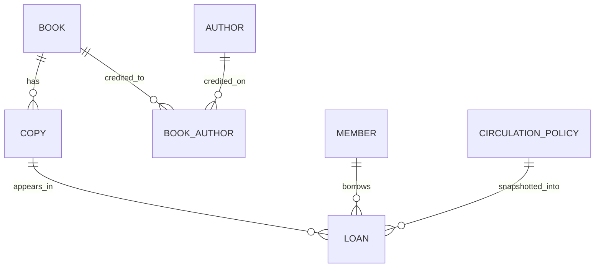

# Database Design Description (DDD)

**Project:** ShelfSense
**Status:** Baseline logical and physical design

## 1. Entity-relationship model

`BOOK` describes a catalog title or edition. `COPY` represents a physical item. `LOAN` connects one member and one copy for an issue/return event. `BOOK_AUTHOR` resolves the many-to-many author relationship. `CIRCULATION_POLICY` holds the current loan and fine rules; relevant values are copied onto each loan.

## 2. Relations and keys

| Relation | Primary key | Candidate/alternate key | Important foreign keys |
| --- | --- | --- | --- |
| book | book_id | isbn13 when present | — |
| author | author_id | — | — |
| book_author | (book_id, author_id) | (book_id, author_order) | book, author |
| copy | copy_id | barcode | book |
| member | member_id | member_number; email when present | — |
| circulation_policy | policy_id | — | — |
| loan | loan_id | one open loan per copy (partial unique index) | copy, member, policy |

The physical schema is [db/001_baseline.sql](../db/001_baseline.sql). A partial unique index on `loan(copy_id) WHERE returned_on IS NULL` enforces the central cardinality rule. Foreign keys preserve history by restricting deletion of referenced records.

## 3. Functional dependencies and normalization

- `book_id → title, isbn13, publication_year`; `copy_id → book_id, barcode, acquired_on, withdrawn_on`.
- `member_id → member_number, full_name, email, active`; `loan_id → copy_id, member_id, dates, policy snapshot`.
- Author names are held in `author`, not repeated in `book`; the junction table contains only the relationship and ordering.
- Non-key attributes in the core relations depend on the whole key and do not contain repeating groups. The baseline is designed to satisfy 3NF; the loan's policy snapshot is deliberate historical data, not a current-policy lookup.

## 4. Fine definition

Let `effective_date = returned_on` for a returned loan, otherwise the requested `as_of_date`. Let `chargeable_days = max(0, effective_date - due_on - grace_days)`. Then:

`fine_minor = min(max_fine_minor, chargeable_days × fine_minor_per_day)`.

The `loan_fines` view uses the database's current date as its stated `as_of_date`. The underlying function also accepts an explicit date for deterministic tests and historical queries. Dates are library-local calendar dates; the application must consistently use the configured library timezone when recording them.

## 5. Transaction and indexing notes

The unique open-loan index remains authoritative even if application checks race. The application must lock member and copy rows before checking loan limits and issuing, and must handle a unique-constraint conflict as a normal business error. Indexes on `loan(member_id)` and `loan(due_on) WHERE returned_on IS NULL` support member history and overdue worklists. Search indexes are deferred until the discovery feature and sample workload are defined.

Holds, payments, audit events, and multi-branch inventory are not represented in the baseline schema. Their designs require separate decisions and migrations rather than speculative columns.

## 6. Change control

Migration files are append-only after adoption. Schema revisions should include a rationale, migration, data preservation plan, and database checks. The initial migration targets a clean database and should not be run twice against the same database.
