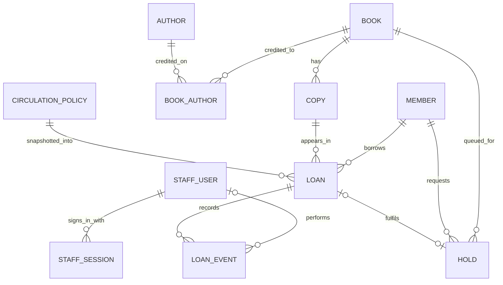

# Database Design Description (DDD)

**Project:** ShelfSense
**Status:** Baseline logical and physical design

## 1. Entity-relationship model

`BOOK` describes a catalog title or edition. `COPY` represents a physical item. `LOAN` connects one member and one copy for an issue/return event. `BOOK_AUTHOR` resolves the many-to-many author relationship. `CIRCULATION_POLICY` holds the current loan and fine rules; relevant values are copied onto each loan. `HOLD` records one member's place in the queue for a title; a fulfilled hold points at the loan that fulfilled it, which is the only optional relationship in the model.

## 2. Relations and keys

| Relation | Primary key | Candidate/alternate key | Important foreign keys |
| --- | --- | --- | --- |
| book | book_id | isbn13 when present | — |
| author | author_id | — | — |
| book_author | (book_id, author_id) | (book_id, author_order) | book, author |
| copy | copy_id | barcode | book |
| member | member_id | member_number; email when present | — |
| circulation_policy | policy_id | — | — |
| loan | loan_id | one open loan per copy (partial unique index) | copy, member, policy |
| hold | hold_id | one active hold per (book_id, member_id) (partial unique index) | book, member, loan (nullable) |
| staff_user | staff_user_id | username | — |
| staff_session | token_hash | — | staff_user |
| loan_event | loan_event_id | — | loan, staff_user (nullable) |

The physical schema is [db/001_baseline.sql](../db/001_baseline.sql), extended by migrations 002 to 006. A partial unique index on `loan(copy_id) WHERE returned_on IS NULL` enforces the central cardinality rule, and `hold(book_id, member_id) WHERE status = 'active'` enforces the equivalent rule for the hold queue. Both are partial so that resolved history — a returned loan, a cancelled hold — does not block a new row. Foreign keys preserve history by restricting deletion of referenced records.

## 3. Functional dependencies and normalization

- `book_id → title, isbn13, publication_year`; `copy_id → book_id, barcode, acquired_on, withdrawn_on`.
- `member_id → member_number, full_name, email, active`; `loan_id → copy_id, member_id, dates, policy snapshot`.
- `hold_id → book_id, member_id, status, placed_at, canceled_at, fulfilled_at, fulfilled_loan_id`. The three resolution columns depend on the whole key and not on `status`; `status` constrains which of them may be present rather than determining their values, which a check constraint enforces instead of a separate relation per state.
- Author names are held in `author`, not repeated in `book`; the junction table contains only the relationship and ordering.
- Non-key attributes in the core relations depend on the whole key and do not contain repeating groups. The baseline is designed to satisfy 3NF; the loan's policy snapshot is deliberate historical data, not a current-policy lookup.

Copy availability and a title's copy counts are derived at read time and are not stored anywhere, so no relation carries a status that could contradict `loan`. `copy_availability` and `title_availability` in migration 003 are views over the base relations.

## 4. Fine definition

Let `effective_date = returned_on` for a returned loan, otherwise the requested `as_of_date`. Let `chargeable_days = max(0, effective_date - due_on - grace_days)`. Then:

`fine_minor = min(max_fine_minor, chargeable_days × fine_minor_per_day)`.

The `loan_fines` view uses the database's current date as its stated `as_of_date`. The underlying function also accepts an explicit date for deterministic tests and historical queries. Dates are library-local calendar dates; the application must consistently use the configured library timezone when recording them.

## 5. Transaction and indexing notes

The unique open-loan index remains authoritative even if application checks race. The application must lock member and copy rows before checking loan limits and issuing, and must handle a unique-constraint conflict as a normal business error. Indexes on `loan(member_id)` and `loan(due_on) WHERE returned_on IS NULL` support member history and overdue worklists.

Holds add a third lock to the circulation order. Because the hold rule compares the number of free copies against the number of members waiting, a decision about one title has to be serialised against every other, which `issue_copy` does by locking the title's `book` row. The resulting order across all circulation operations is `member` → `book` → `copy` → `loan` → `hold`, and each operation takes a subset of it in that order. The [Discovery and reporting](discovery-and-reporting.md) description, section 3, records which operation takes which locks.

Search indexes are no longer deferred: migration 003 adds GIN indexes on `to_tsvector('simple', title)` and `to_tsvector('simple', display_name)`, a btree on `book_author(author_id)` for the author-to-titles traversal, and a btree on `book(title)` for paginated catalog browsing. Each one was measured with and against its absence on a 20,000-title, 150,000-loan dataset, and one further index proposed for the hold queue was measured and rejected as redundant. The results are in [Query performance](query-performance.md).

Migration 006 records issue and return audit events through triggers, including an optional staff actor. Payments and multi-branch inventory are not represented. MongoDB reading lists are a separate document model, described in [Application and NoSQL design](application-and-nosql.md).

## 6. Change control

Migration files are append-only after adoption. Schema revisions should include a rationale, migration, data preservation plan, and database checks. The initial migration targets a clean database and should not be run twice against the same database.

Revising behavior therefore means replacing a function in a later migration rather than editing an earlier file. Migration 004 does this to `issue_copy` and `hold_permits_issue`: migration 002 created `hold_permits_issue` as the place the hold rule would be evaluated, and 004 replaces its body with the real rule and adds the fulfillment step to `issue_copy`. Reading either function's current definition means reading the latest migration that replaces it.
